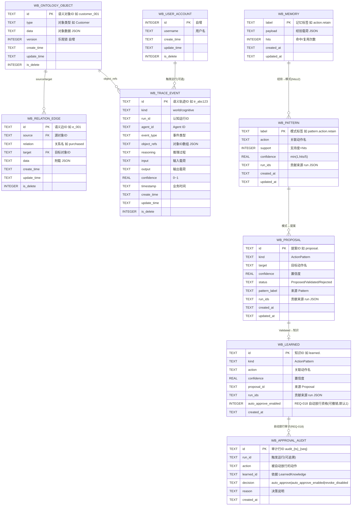

# 数据库 ER 图说明
## 基本信息
| 项 | 内容 |
|----|------|
| 文档ID | WB-DOC-04-001 |
| 所属模块 | OpenAIP-OS-DB |
| 版本 | V1.2 |
| 创建人 | lushaohui |
| 创建时间 | 2026-08-11 |
| 更新记录 | 见文末修订日志 |
| 生效环境 | 开发/测试/预发/生产 |

## 1. 文档目的
呈现全局 ER 图与实体关系说明。

## 2. 业务/技术背景
依赖 module-split.md 与 table-design.md。

## 3. 核心规则 & 约束（重点）
- [强制] 必须含全局 ER 图（优先用内联 Mermaid `erDiagram` 渲染，零二进制依赖；如需位图放 /docs/assets/ 并相对路径引用）。
- [强制] 标注实体间基数关系（1:1 / 1:N / M:N）。

## 4. 详细设计/内容
### 4.1 ER 总图

### 4.2 实体关系说明
| 实体 A | 关系 | 实体 B | 说明 |
|--------|------|--------|------|
| wb_ontology_object | 1:N | wb_relation_edge | 一个对象可作 source / target 出现在多条边，构成世界图 |
| wb_ontology_object | 1:N | wb_trace_event | 对象生命周期事件经 `object_refs` 绑定，可解释性根基 |
| wb_user_account | 1:N | wb_trace_event | 触发 Agent 运行的用户（可选，经 `run_id` 关联） |
| wb_memory | 1:N | wb_pattern | 经验（hits≥2）经 `mine_patterns` 提炼为 Pattern（Agent 自治·REQ-016→REQ-017） |
| wb_pattern | 1:N | wb_proposal | Pattern 经 `propose` 生成 Proposal，携带来源 pattern_label |
| wb_proposal | 1:1(条件) | wb_learned | 仅 Validated 的 Proposal 沉淀为 LearnedKnowledge（携 proposal_id），Learn≠Permission 不回写 Policy |
| wb_learned | 1:N | wb_approval_audit | REQ-018 自动放行审计：每次自动放行/资格切换落库（decision=auto_approve/auto_approve_enabled/revoke_disabled），经 learned_id 关联 |

## 5. 风险点 & 注意事项
- ER 图与表结构不一致需立即同步。

## 6. 关联文档
- [../04_数据库设计/table-design.md](../04_数据库设计/table-design.md)
- [../04_数据库设计/data-dict.md](../04_数据库设计/data-dict.md)

## 修订日志
| 版本 | 修改人 | 修改日期 | 修改内容 |
|------|--------|----------|----------|
| V1.0 | lushaohui | 2026-08-11 | 初稿完成 |
| V1.1 | lushaohui | 2026-08-11 | 4.1 改为内联 Mermaid erDiagram（去不存在的 db-erd.png 绝对路径）；4.2 填充实体关系表 |
| V1.2 | lushaohui | 2026-08-12 | ER 总图新增 WB_MEMORY / WB_PATTERN / WB_PROPOSAL / WB_LEARNED 四实体（V0.5 记忆沉淀 + BL-003 Evolution），4.2 补实体关系（Experience→Pattern→Proposal→LearnedKnowledge 可追溯链） |
| V1.3 | lushaohui | 2026-08-12 | REQ-018 新增 WB_APPROVAL_AUDIT 实体（4.2 补 wb_learned 1:N wb_approval_audit 关系，经 learned_id 关联，支撑自动放行可审计） |

